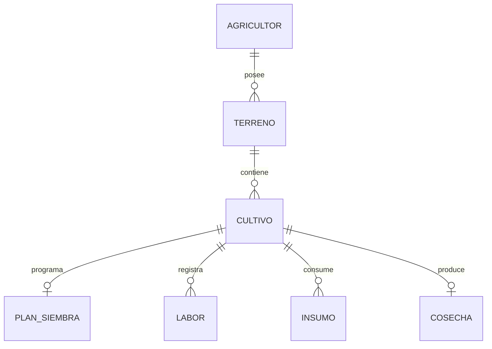

# Esquema SQLite real — versión 1

Fuente de verdad: `lib/core/database/database_migrations.dart`. `DatabaseHelper` usa `allpa_database.db`; Android/iOS lo guarda en la ruta administrada por sqflite. No se conserva una base real en el repositorio. `PRAGMA foreign_keys = ON` se ejecuta al configurar la conexión. Columnas `created_at` se almacenan como texto ISO en el código.

| Tabla | Columnas (tipo; restricciones) | Relación |
|---|---|---|
| agricultor | id INTEGER PK AUTOINCREMENT; nombre TEXT NOT NULL; codigo_local TEXT NOT NULL UNIQUE; documento TEXT; telefono TEXT; comunidad/distrito/provincia/departamento TEXT NOT NULL con defaults Illpe/Pachamarca/Churcampa/Huancavelica; siembra_individual INTEGER NOT NULL DEFAULT 1; created_at TEXT NOT NULL | Raíz |
| terreno | id INTEGER PK; agricultor_id INTEGER NOT NULL; nombre TEXT NOT NULL; area_ha REAL NOT NULL CHECK > 0; ubicacion TEXT; created_at TEXT NOT NULL | agricultor 1:N; FK RESTRICT |
| cultivo | id INTEGER PK; terreno_id INTEGER NOT NULL; especie TEXT NOT NULL; variedad TEXT; area_sembrada_ha REAL NOT NULL DEFAULT 0; fecha_inicio TEXT NOT NULL; estado TEXT NOT NULL DEFAULT 'En curso'; created_at TEXT NOT NULL | terreno 1:N; FK RESTRICT |
| plan_siembra | id INTEGER PK; cultivo_id INTEGER NOT NULL UNIQUE; fecha_prevista TEXT; fecha_real TEXT; escrito INTEGER NOT NULL DEFAULT 1 CHECK 0/1; desfase_dias INTEGER; estado TEXT NOT NULL DEFAULT 'Pendiente'; observacion TEXT; created_at TEXT NOT NULL | cultivo 1:0..1; FK CASCADE |
| labor | id INTEGER PK; cultivo_id INTEGER NOT NULL; tipo TEXT NOT NULL; fecha TEXT NOT NULL; jornales REAL NOT NULL DEFAULT 0 CHECK >= 0; nota TEXT; created_at TEXT NOT NULL | cultivo 1:N; FK CASCADE |
| insumo | id INTEGER PK; cultivo_id INTEGER NOT NULL; tipo/nombre TEXT NOT NULL; cantidad REAL NOT NULL CHECK >= 0; unidad TEXT NOT NULL; fecha TEXT NOT NULL; created_at TEXT NOT NULL | cultivo 1:N; FK CASCADE |
| cosecha | id INTEGER PK; cultivo_id INTEGER NOT NULL UNIQUE; fecha TEXT NOT NULL; area_ha REAL NOT NULL CHECK > 0; produccion_kg REAL NOT NULL CHECK >= 0; jornales REAL NOT NULL DEFAULT 0 CHECK >= 0; rendimiento_kg_ha REAL; productividad_kg_jornal REAL; observacion TEXT; created_at TEXT NOT NULL | cultivo 1:0..1; FK CASCADE |

Índices: `idx_terreno_agricultor(agricultor_id)`, `idx_cultivo_terreno(terreno_id)`, `idx_labor_cultivo_fecha(cultivo_id, fecha)`, `idx_insumo_cultivo_fecha(cultivo_id, fecha)`. Versión declarada: 1. `onUpgrade` no contiene aún migraciones efectivas.

