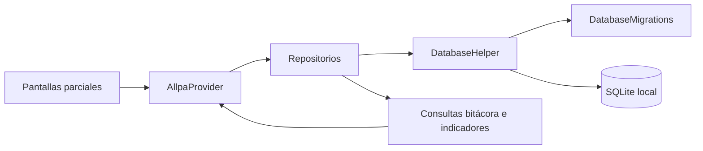
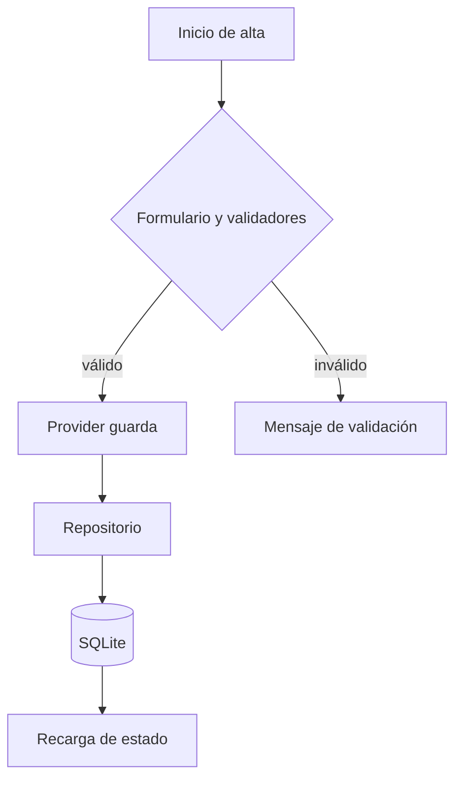

# Diagramas derivados del código

Estos diagramas reflejan clases y relaciones de persistencia presentes. No afirman que los flujos estén accesibles desde la app ejecutable.

El modelo entidad-relación está en `../02_base_datos/ESQUEMA_SQLITE.md`. El diagrama de casos de uso aún es una especificación de requerimientos: perfil, terrenos, cultivos/siembra, labores/insumos, bitácora y cosecha; su aceptación debe comprobarse luego de integrar la navegación.