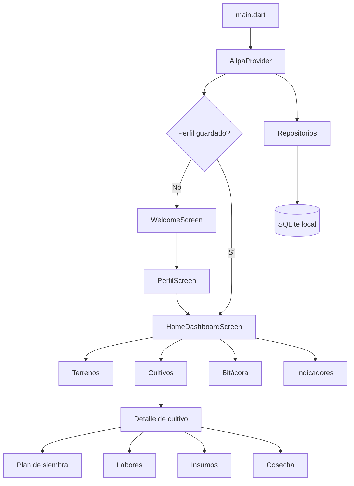
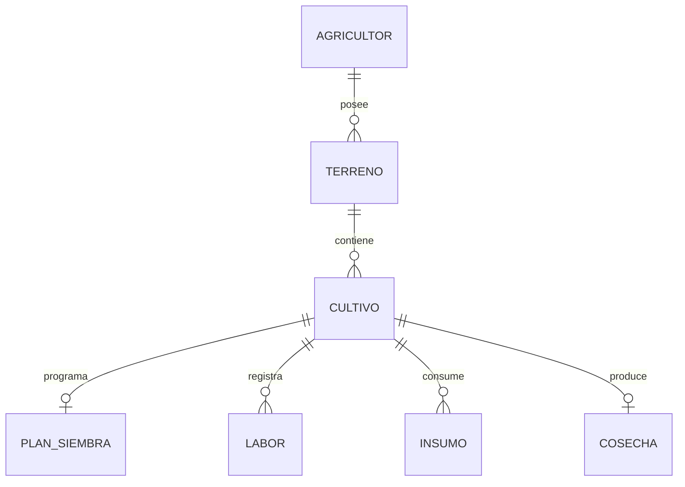

# Diagramas derivados de la implementación

## Componentes y flujo

## Entidades y relaciones

Los diagramas reflejan componentes y relaciones observables en el código y el esquema SQLite. La prueba Android OFF-01 confirma persistencia del perfil sintético tras relanzar sin red (EV-13), no la persistencia de todas las entidades ni aceptación de usuarios. Para el detalle de verificaciones, consulte `../05_pruebas/RESULTADOS.md`.
